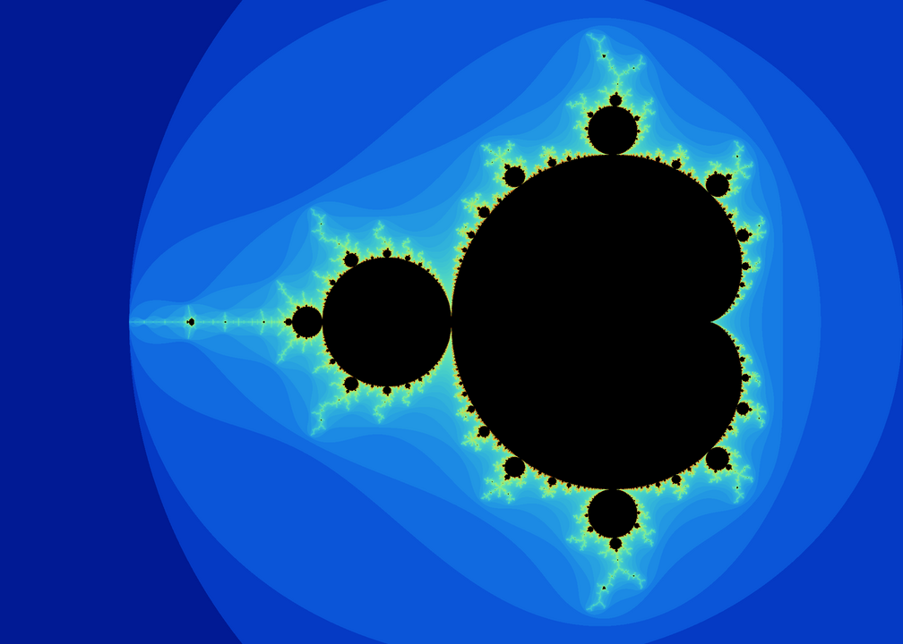
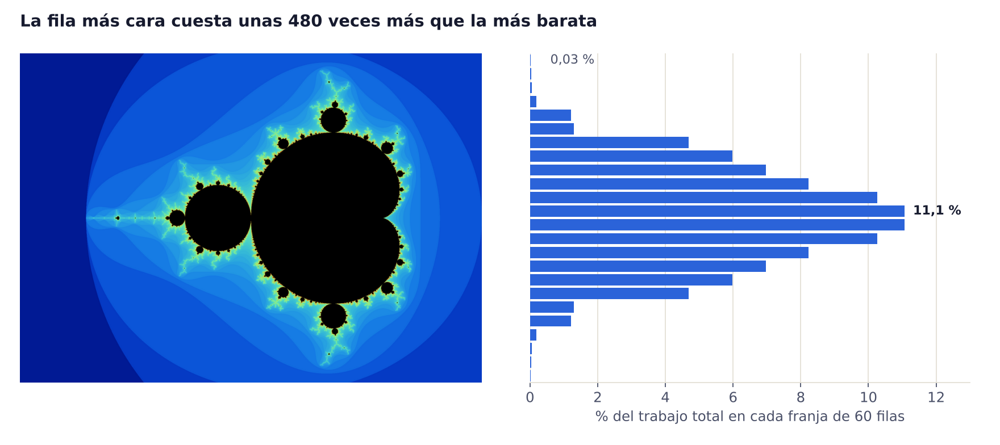
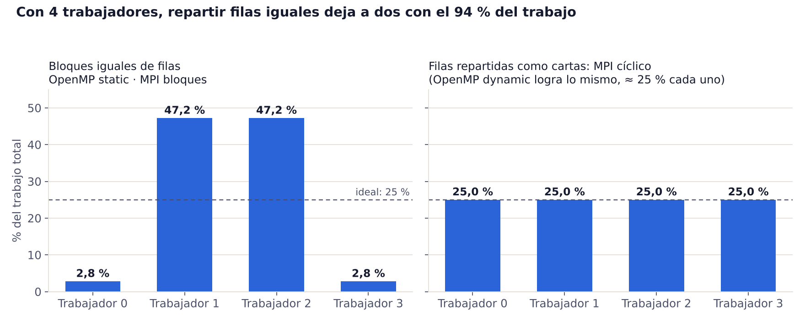

# Cómo funciona

## 1. El problema: dibujar el conjunto de Mandelbrot

Cada píxel de la imagen representa un número complejo **c**. Se arranca con z = 0 y se repite:

```
z ← z² + c
```

- Si |z| pasa de 2, el punto se escapa al infinito: se corta y el color indica en qué vuelta se escapó.
- Si después de `max_iter` vueltas (2000 por defecto) sigue acotado, el punto pertenece al conjunto y se pinta de negro.

El programa dibuja la zona clásica del plano (x de −2,5 a 1; y de −1,25 a 1,25) en una imagen de 2016 × 1440 píxeles: unos 2,9 millones de píxeles y 1.014 millones de iteraciones en total.



## 2. La clave: no todas las filas cuestan lo mismo

Cada fila se puede calcular sin depender de las demás, así que el problema se reparte fácil entre hilos o procesos. Lo que no es parejo es el costo. Un píxel negro hace las 2000 vueltas completas; uno de afuera se resuelve en pocas. Las filas del medio atraviesan la zona negra, y la más cara cuesta unas 480 veces más que la más barata.



Por eso **repartir la misma cantidad de filas no es repartir la misma cantidad de trabajo**.

## 3. Diseño: un cálculo, tres formas de repartirlo

Todo el cálculo está en [`src/mandelbrot_comun.h`](../src/mandelbrot_comun.h):

| Función | Qué hace |
|---|---|
| `iteraciones_pixel(cx, cy, max_iter)` | Repite z ← z² + c para un píxel y devuelve en qué vuelta se escapó. |
| `calcular_fila(y, …, fila)` | Calcula una fila entera y devuelve cuántas iteraciones costó (el "trabajo"). |
| `guardar_ppm(...)` | Pasa las iteraciones a colores y guarda la imagen en formato PPM. |
| `leer_parametros(...)` | Lee ancho, alto e iteraciones de la línea de comandos. |

Las tres versiones llaman a la misma `calcular_fila`. Así, la única diferencia entre ellas es quién calcula cada fila, y los resultados se pueden comparar byte por byte.

## 4. Versión OpenMP: hilos con memoria compartida

[`src/mandelbrot_omp.cpp`](../src/mandelbrot_omp.cpp) es el bucle secuencial con una directiva:

```cpp
#pragma omp parallel for schedule(dynamic) reduction(+:total)
for (int y = 0; y < alto; y++)
    total += procesar_fila(y);
```

- `parallel for` crea un equipo de hilos y les reparte las vueltas del `for` (modelo fork / join).
- `schedule(...)` decide cómo se reparten. El programa permite elegir entre tres:
  - `static`: bloques iguales y seguidos, decididos de antemano.
  - `dynamic`: cada hilo pide una fila; cuando termina, pide otra.
  - `guided`: como `dynamic`, con pedazos que empiezan grandes y se achican.
- `reduction(+:total)` hace que cada hilo sume en su propia copia de `total`; al final OpenMP las junta. Sin eso, los hilos se pisarían al sumar.
- **No hay condición de carrera en la imagen.** Todos escriben en el mismo vector, pero cada fila la escribe un solo hilo.

## 5. Versión MPI: procesos con memoria distribuida

En [`src/mandelbrot_mpi.cpp`](../src/mandelbrot_mpi.cpp) cada proceso tiene su propia memoria y todo lo que se comparte viaja como mensaje. Todos ejecutan el mismo programa (modelo SPMD) y se distinguen por su `rank`.

1. **`MPI_Bcast`:** el proceso 0 lee los parámetros y se los manda a todos. Si el alto no es múltiplo de la cantidad de procesos, lo redondea hacia arriba. Así todos reciben la misma cantidad de filas, como necesita `MPI_Gather`.
2. **Cálculo local:** cada proceso calcula sus filas en su vector `local`. La fila global que le toca se calcula así:
   - por bloques: `p * filas_por_proceso + k` (filas seguidas: 0 0 0 1 1 1 2 2 2 …)
   - cíclico: `k * procesos + p` (como repartir cartas: 0 1 2 3 0 1 2 3 …)
3. **`MPI_Gather`:** todos mandan su vector `local` al proceso 0, que pone cada fila en su lugar real.
4. **`MPI_Reduce`:** se suman las iteraciones de todos para obtener la suma de control.

También se usan `MPI_Barrier`, para que todos arranquen a la vez, y `MPI_Wtime`, para medir. El tiempo que se informa incluye la comunicación.

## 6. Balanceo de carga

Con 4 trabajadores, el reparto por bloques iguales deja dos trabajadores casi sin nada y dos con el 47,2 % cada uno. El reparto cíclico de MPI le da exactamente el 25 % a cada uno. `schedule(dynamic)` en OpenMP logra lo mismo de forma automática.



Ningún programa paralelo termina antes que su trabajador más cargado. Con bloques, el speedup con 4 núcleos no podría pasar de 100 ÷ 47,2 ≈ 2,1. Con un reparto equilibrado, puede acercarse a 4. Las mediciones están en [resultados.md](resultados.md).

## 7. OpenMP y MPI, lado a lado

| | OpenMP | MPI |
|---|---|---|
| Memoria | Compartida | Distribuida: cada proceso, la suya |
| Quién trabaja | Hilos de un mismo programa | Procesos independientes |
| Comunicación | Variables compartidas | Mensajes: `Bcast`, `Gather`, `Reduce` |
| Dónde corre | Una computadora con varios núcleos | Una o varias computadoras (clúster) |
| Cambios al código | Una línea: `#pragma omp parallel for` | Repartir, enviar y juntar a mano |
| Balanceo de carga | `schedule(dynamic)` | Reparto cíclico |
| Speedup medido con 2 núcleos | ×2,0 | ×2,0 |

## Referencias

- Laboratorios de la cátedra: tutoriales de MPI (Hola Mundo, Send/Receive, Producto escalar) y de OpenMP (Hola Mundo, For paralelo, Sections, Costo de hebras), de la web de Programación Distribuida y Paralela de Daniel Guerrero Martínez y Sergio Rodríguez Lumley (2010).
- José Miguel Mantas Ruiz, *Introducción a la Interfaz de paso de mensajes (MPI)* y *Programación Multihebra con OpenMP*, Depto. de Lenguajes y Sistemas Informáticos, Universidad de Granada.
